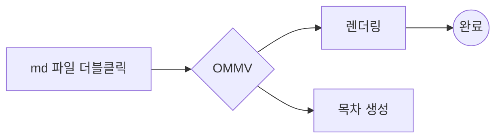
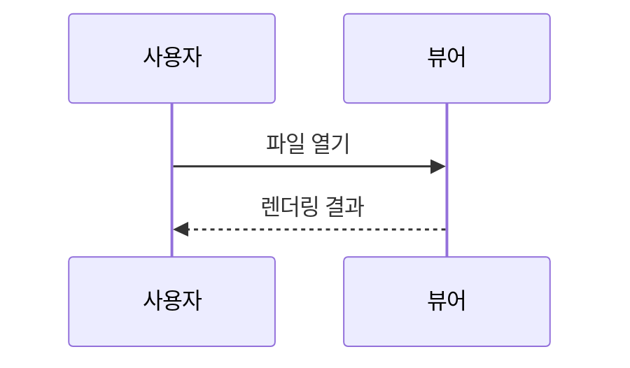

# OMMV 샘플 문서

Windows용 **Markdown 뷰어**의 렌더링 테스트 문서야. ~~취소선~~, *기울임*, `인라인 코드`, ==형광펜==, H~2~O, E=mc^2^, :tada: 이모지, 자동 링크 https://example.com 까지.

> [!NOTE]
> GitHub 스타일 알림도 지원해.

> [!WARNING]
> 경고 박스 예시야.

## 목차와 링크

- 같은 문서 안: [코드 블록으로 이동](#코드-블록)
- 다른 문서: [sub.md 열기](sub.md)
- 외부: [Anthropic](https://www.anthropic.com)

## 표

| 기능 | 지원 | 비고 |
|:-----|:----:|-----:|
| GFM 표 | ✅ | 정렬 지원 |
| Mermaid | ✅ | 지연 로딩 |
| KaTeX | ✅ | 인라인/블록 |

## 작업 목록

- [x] 마크다운 렌더링
- [x] 다크 모드
- [ ] 기본 앱 등록

## 코드 블록

```python
def fib(n: int) -> int:
    """피보나치"""
    return n if n < 2 else fib(n - 1) + fib(n - 2)

print([fib(i) for i in range(10)])
```

```js
const greet = (name) => `안녕, ${name}!`;
console.log(greet("대장"));
```

```powershell
Get-ChildItem -Recurse -Filter *.md | Select-Object FullName
```

## 수식

인라인 수식 $E = mc^2$ 과 블록 수식:

$$
\int_{-\infty}^{\infty} e^{-x^2}\,dx = \sqrt{\pi}
$$

## Mermaid 다이어그램





## 이미지


## 각주와 정의 목록

각주 예시[^1] 하나 더[^note].

용어
: 정의 목록(definition list) 예시.

[^1]: 첫 번째 각주.
[^note]: 이름 붙은 각주.

## 보안 테스트

<script>document.title = "HACKED"</script>

<details><summary>HTML details 는 허용</summary>접었다 펼 수 있어.</details>

## 중복 제목
### 중복 제목
